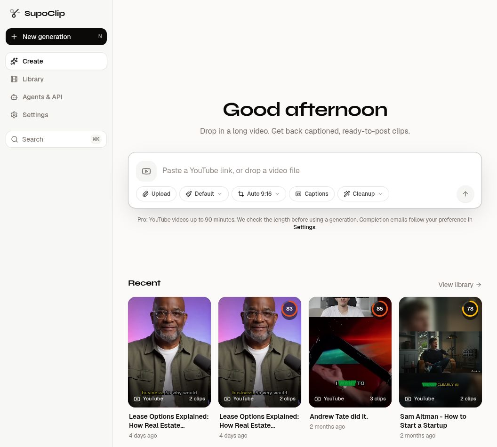
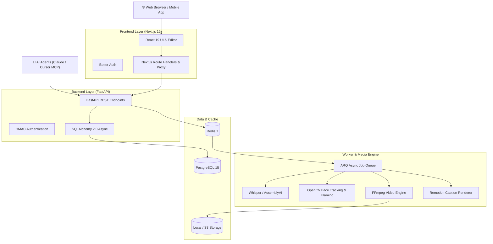

<div align="center">
  

  # 🎬 Clipper AI

  **Transform long-form videos into high-engagement, viral-ready vertical shorts with AI.**

  [](https://www.typescriptlang.org/)
  [](https://nextjs.org/)
  [](https://fastapi.tiangolo.com/)
  [](https://python.org/)
  [](https://www.docker.com/)
  [](LICENSE)

  <br />

  [Features](#-key-features) •
  [Architecture](#-architecture) •
  [Tech Stack](#-tech-stack) •
  [Quick Start](#-quick-start) •
  [Configuration](#-configuration) •
  [MCP Server](#-model-context-protocol-mcp) •
  [License](#-license)
</div>

---

## 🚀 Key Features

- **🎯 Smart AI Highlight Detection**: Analyzes audio transcripts with state-of-the-art LLMs (OpenAI, Gemini, Anthropic, or local Ollama) to identify viral hooks, narrative arcs, and punchlines.
- **📐 Intelligent 9:16 Reframing**: Automated computer vision face tracking and speaker detection keeps the subject centered in dynamic vertical orientation.
- **💬 Dynamic Animated Subtitles**: Word-level synchronized captions with customizable font styles, highlighted keywords, emoji overlays, and smooth karaoke animations.
- **📥 Universal Ingestion**: Accepts YouTube URLs, Twitch / Kick streams and VODs, or local uploads up to 4 GB (MP4, MOV, MKV, WebM).
- **🎨 Interactive Web Editor**: Fine-tune clip start/end boundaries, tweak wording, adjust face-crop framing, and switch subtitle styles in real-time.
- **📱 Direct Multi-Platform Publishing**: Schedule and publish clips directly to TikTok, YouTube Shorts, and Instagram.
- **🤖 Agentic Automation via MCP**: Bundled Model Context Protocol (MCP) server enables AI agents (Claude Code, Cursor, Windsurf) to generate and manage clips automatically.

---

## 🏛 Architecture



---

## 💻 Tech Stack

| Domain | Technologies |
| :--- | :--- |
| **Frontend** | Next.js 15 (App Router), React 19, Tailwind CSS, Radix UI, Better Auth, Prisma |
| **Backend API** | Python 3.11, FastAPI, Pydantic, SQLAlchemy 2.0 (AsyncPG), Alembic |
| **Media & AI** | FFmpeg, OpenCV, OpenAI Whisper, AssemblyAI, Remotion |
| **Task Queue & Cache** | Redis 7, ARQ Worker Pool |
| **Database** | PostgreSQL 15 |
| **AI Providers** | OpenAI (GPT-4o), Anthropic Claude, Google Gemini, Ollama (Local) |
| **Automation** | Model Context Protocol (MCP Server) |

---

## ⚡ Quick Start

### Option 1: Docker Compose (Recommended)

Start the complete stack (Frontend, Backend, Worker, Redis, and Postgres) with a single command:

```bash
docker-compose up -d --build
```

- **Frontend Web UI**: [http://localhost:3107](http://localhost:3107)
- **Backend API & Swagger Docs**: [http://localhost:8000/docs](http://localhost:8000/docs)

To stop services:
```bash
docker-compose down
```

---

### Option 2: Local Development Setup

#### 1. Prerequisites
- **Node.js** >= 20, **pnpm** >= 9
- **Python** >= 3.11, **uv** package manager
- **FFmpeg** installed locally and in `PATH`
- **PostgreSQL** and **Redis** running locally

#### 2. Environment Configuration
Copy the template and fill in your keys:
```bash
cp .env.example .env
```
Ensure you provide:
- `OPENAI_API_KEY` (or configured LLM provider)
- `ASSEMBLY_AI_API_KEY` (or configure local Whisper)

#### 3. Backend Setup
```bash
cd backend
uv sync
uvicorn src.main:app --reload --host 0.0.0.0 --port 8000
```
In a second terminal, start the background video worker:
```bash
cd backend
.venv/bin/python -m src.workers.run_workers
```

#### 4. Frontend Setup
```bash
cd frontend
pnpm install
pnpm run dev
```
Visit `http://localhost:3107` to access Clipper AI.

---

## ⚙ Configuration

Key environment variables in `.env`:

| Variable | Description | Default |
| :--- | :--- | :--- |
| `DATABASE_URL` | PostgreSQL connection string | `postgresql+asyncpg://...` |
| `REDIS_HOST` | Redis server hostname | `localhost` |
| `LLM` | Primary LLM for clip detection | `openai:gpt-4o` |
| `OPENAI_API_KEY` | OpenAI API key | - |
| `TRANSCRIPTION_PROVIDER` | `assemblyai` or `whisper` | `assemblyai` |
| `ASSEMBLY_AI_API_KEY` | AssemblyAI API key | - |
| `MEDIA_STORAGE` | Storage mode (`local` or `s3`) | `local` |
| `FRONTEND_PORT` | Local frontend port | `3107` |

---

## 🤖 Model Context Protocol (MCP)

Clipper AI includes a native MCP server (`mcp/`) allowing autonomous agents in Cursor, Claude Code, or Windsurf to trigger clipping tasks directly.

Add to your MCP settings (`claude_desktop_config.json` or Cursor MCP settings):

```json
{
  "mcpServers": {
    "clipper-ai": {
      "command": "uv",
      "args": ["run", "--directory", "/path/to/Clipper AI/mcp", "clipper-ai-mcp"],
      "env": {
        "CLIPPER_API_URL": "http://localhost:8000",
        "CLIPPER_API_KEY": "sk_your_api_key_here"
      }
    }
  }
}
```

---

## 🔒 Security & Support

Please review [SECURITY.md](SECURITY.md) for vulnerability disclosure guidelines. For technical questions or issue reports, reach out to `support@clipper.ai`.

---

## 📄 License

Proprietary and Confidential. Copyright (c) 2026 Clipper AI. All rights reserved.
Unauthorized copying, modification, distribution, or commercial use is strictly prohibited.
